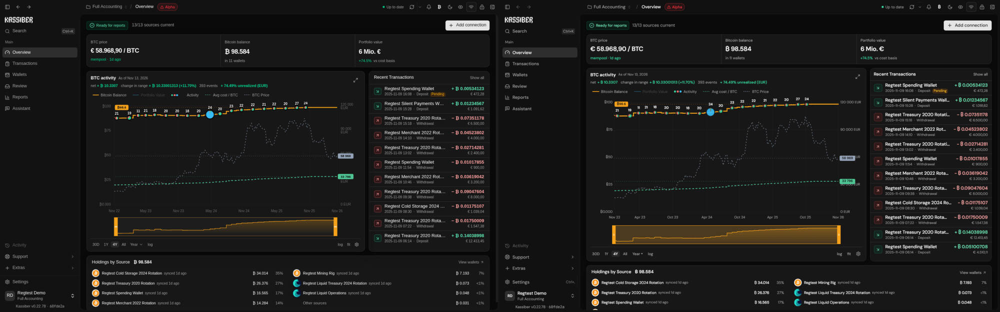
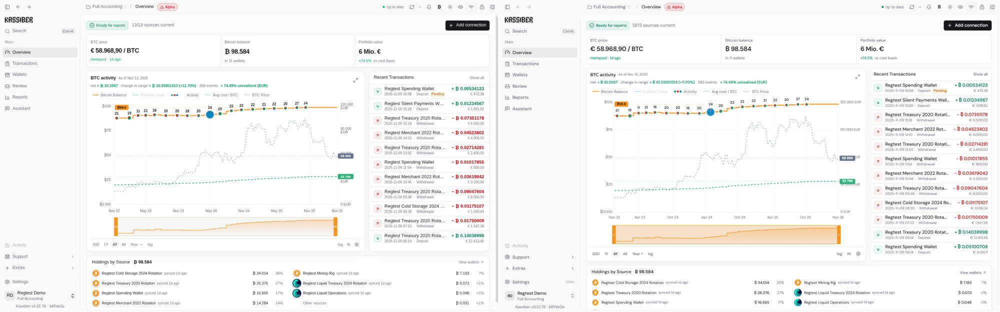
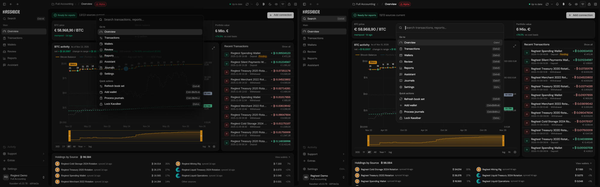
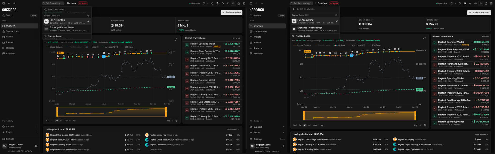
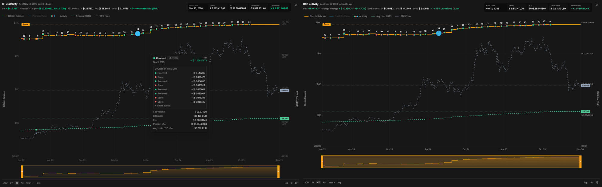
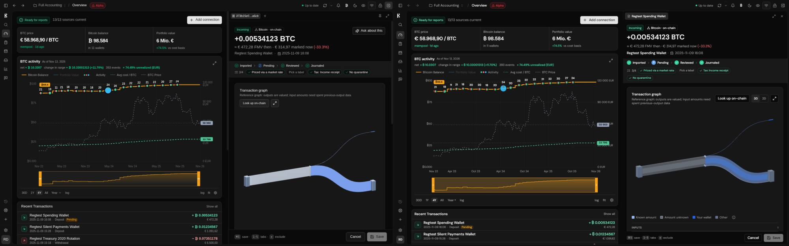

# Rune vs Tauri + React: the Overview screen as a test case

> **Historical record.** This is the evaluation that led Kassiber to adopt the Rune app as its
> desktop (November 2026). Its "spike" wording, gaps and figures describe that moment, not the
> current app; see the [crate README](../../README.md) for the app as it is.

Status: evaluation, 2026-11-14. Decision pending with the owner. Option B (the second pilot)
ran on 2026-11-15; see [PILOT.md](pilot.md).

Kassiber's backend is Rust only since plan 22. This spike asks whether the desktop UI should
follow, using [Rune](https://github.com/anomalyco/rune) (Anomaly's native, GPU-rendered Rust UI
framework). The test case is the full window shown when Overview is open: the app shell, the
dashboard, the chart with all its controls, and the popovers and sheets reachable from them.
Both versions ran on the same regtest demo book (998 transactions, 13 wallets, 2,635 daily
portfolio points) and the same release `kassiber` daemon.

## Summary

- **Fidelity: the rebuild is close to pixel-level on the main page.** The shell, stats, chart
  (all five series, merged dots with counts, tags, brush, toolbar), recent transactions and
  holdings match closely in light and dark. The number formatting matches the web's `Intl`
  output. The gaps are listed below; the biggest is the transaction detail view.
- **Runtime: Rune is much lighter.**
  - It draws the page from daemon data in 60–80 ms of CPU, and clicks finish within a frame.
    The React app needs about 1 s to a fully rendered Overview, and 365–640 ms for a range
    switch or currency toggle.
  - Memory is about 190 MB RSS against a browser engine.
  - The executable is 36 MB stripped, with no webview.
- **Engineering: Rune is the risk.**
  - It is pre-release. Apps pin a `dev` revision.
  - One vendor owns it, and it "doesn't take pull requests".
  - Higher-level components are missing for Kassiber's needs: page dialogs and sheets, CSS grid
    and container queries, charts, shape primitives, text measurement in view code.
  - Every Rust change costs a rebuild (about 1 min incremental under load). React edits reload
    instantly with Vite HMR.
  - Wgpu needs GPU memory, and fails hard when there is none.
- **Scale of a full migration.** The React UI is about 154k lines of non-test TS/TSX, plus 54k
  lines of tests, 20k lines of i18n JSON and 11.5k lines of Tauri Rust. This spike replaced a
  slice of about 16k React lines with 10.4k Rust lines. It took four parallel agents about
  50 minutes, after two spec passes.

The decision options are at the end.

## What was rebuilt

| Area | Status in Rune |
| --- | --- |
| Shell layout | Same geometry and tokens: the 40 pt title bar, the 16 rem sidebar or 3 rem rail (⌘B, auto-folds below 1100 pt), and the rounded page panel |
| Sidebar | Pixel wordmark, Search (⌘K), Main nav with review badge rules, dev-locked Activity, Support and Extras collapsibles, Settings modal (placeholder), book-set menu, version line |
| Title bar | Back/forward, book switcher (`ui.profiles.snapshot` / `ui.profiles.switch`), page title, Alpha chip |
| Title bar, right cluster | Freshness indicator, refresh split button (`ui.freshness.run`, `ui.journals.process`), notifications, ₿/€ toggle, theme (System/Light/Dark), privacy modes, network status (offline switch; connection probes only on click), lock screen, side panel |
| Search palette | Launcher, typed search over pages, actions, settings, wallets and transactions, `ui.transactions.resolve` for txids |
| Feedback | Toasts, sync card, route progress line |
| Keyboard | The shell shortcuts: mod+K/B/L/R, mod+⇧R/J/A/H, [ ], Alt+arrows, mod+1–9, UI scale |
| Overview | Readiness pill (all 9 rules), stats cards (`ui.rates.latest` refresh), the two-column layout at 64 rem and up with "rows that fit", recent transactions, holdings by source with rail logos, loading/error/empty states, privacy and currency modes |
| Chart | Full port of the `model.ts` pipeline: periods, auto period, sampling, flows, anchoring, merging, msat-exact change. Axes: log, fit and power-law time. Tooltips, last-value tags, basis-incomplete hatch and popover, legend, range/Year/log/fit, gear menu and submenus, controls sheet, brush, expanded dialog with inspector |
| Transaction detail | Right-side sheet with header, tabs, a Details table, and live attachment/history/journal-event lists. Note editing through `ui.transactions.metadata.update` |
| Add connection | Source picker with all 47 catalog entries; picking one navigates (simplified) |

**Gaps:**
- **Transaction detail:** the web now uses a docked right panel with the transaction graph and
  process steps. The spike has a modal sheet without the graph, and only the note is editable.
- **Add connection:** has no setup forms.
- **Chart persistence:** period and settings are session-only. There is no per-book store and no
  URL parameters.
- **Not built:**
  - localization (English only, no de-AT);
  - the native menu bar;
  - update checks;
  - passphrase or Touch ID unlock;
  - every screen other than Overview.

The shell worker also noted that the book-set menu lists every Kassiber project the daemon
knows, including the account's default one. That is the same behaviour as the web app.

## Side by side

In each image Tauri (headless Chromium) is on the left and Rune (its own renderer) on the
right, both at 1440×900. All screenshots, including menus, popovers, the sync card and toasts,
were produced headless from the same book.

Visible differences on the main page:
- The quarter tick labels differ (Tauri May/Nov, Rune Apr/Oct).
- Rune's brush is slightly taller.
- Tauri wraps the right axis's "EUR" onto a second line.
- Rune fits 12 recent rows next to the chart; Tauri fits 11.

## Measurements

**Test conditions:**
- Machine: 48 cores; load average 190–700 during the runs, from other builds.
- GPU: both RTX 3090s were about 98 % full, held by a local model server.
- Tauri side: the production bundle in headless Chromium through the Vite daemon bridge. The
  shipped Linux app uses WebKitGTK, so its webview numbers are indicative only.
- Rune side: the release build, headless or in a native Wayland/Vulkan window.

| | Tauri + React | Rune |
| --- | --- | --- |
| Startup to a fully drawn Overview | ~1.0 s after navigation (cold median 1,059 ms, warm 956 ms); browser process start and Tauri start not included | ~0.8 s for the whole process: daemon spawn, 7 reads, 280–430 ms GPU init, first frame, PNG encode. The first frame from data takes 60–80 ms of CPU |
| `ui.overview.snapshot` (1.28 MB JSON) | ~213 ms through the bridge; other startup reads queue behind it (~205–733 ms) | ~300 ms for all 7 startup reads over stdin/stdout |
| Range "All" click | 639 ms to updated DOM | next frame; scripted run p50 2.0 ms, p95 5.9 ms per frame |
| Currency toggle | 365 ms | next frame (same run) |
| Chart hover | 16.7 ms frames (vsync-bound; no long tasks) | 1.6 ms p50 / 2.7 ms p95 CPU; 0.24 ms within a column (live values); brush drag 2.1 ms |
| Expanded chart hover (420 points) | not measured | 5.1 ms p50 / 6.8 ms p95 |
| Memory | Chromium tree 1.5 GB RSS; renderer 526 MB; JS heap 36–42 MB | ~190 MB peak RSS for the native window, including Vulkan driver mappings |
| Shipped UI size | 5.1 MB JS (1.5 MB gzip) + 279 KB CSS, plus the Tauri shell binary and the OS webview | 36 MB stripped executable, statically linked: wgpu, text stack, fonts, the whole UI |
| Rendered elements | 1,124 DOM nodes (499 SVG), 3,125 listeners | 632 layout nodes, about 7,000 GPU instances, 1 draw call per frame |
| Idle | event loop and timers; polls `ui.logs.snapshot` every 4 s | draws nothing at rest |

**Engine caveats:**
- **Text blur:** Rune's blur on text is expensive. The hide-amounts first frame took 245 ms
  before caching.
- **Shape fills:** Rune's shape fills are ear-clipped, O(n²). A 1,440-vertex area polygon cost
  47 ms until it was split into quads.
- **GPU memory:** at 2× scale, with GPU memory full, wgpu panicked with "Out of Memory" instead
  of degrading. A webview would have degraded.

## Development experience

**What worked well in Rune:**
- **Headless verification:** `--snap`, `--script`, `--tree` and `--trace` render every state to
  PNG on a virtual clock without a display. All the comparison shots and timings above come from
  that, so agents can check their own UI work. That is Rune's stated design goal, and it held up.
- **Model code is plain Rust.** The `model.ts` port (readiness, stats, holdings, the chart
  pipeline) lives next to the daemon types and is unit-testable with `cargo test`. Today about
  2,600 lines of business-shaped TypeScript (`model.ts`) sit outside the Rust core. In Rust, these
  rules could move into the crates that the CLI, daemon and AI already share, as the root
  `AGENTS.md` asks.
- **Cheap per-frame updates:** `Live` values with `tx.live_only()` make hover and drag nearly
  free.
- **Popover anchoring:** rune-kit's menus, submenus and popover anchoring worked on the first
  try.
- **Talking to the daemon:** a 160-line JSONL client replaced the Tauri supervisor plus the
  bridge for this purpose.

**What cost time:**
- **No CSS grid or container queries.** Breakpoints, column-first flows and "rows that fit" are
  hand-written arithmetic over `Cx::layout_size`.
- **No page dialog or sheet.** `rune_kit::Dialog` is a fixed small modal, so the sheet, dialog
  and tabs were built by hand.
- **rune-kit looks like OpenCode** (its menus and popovers follow `@opencode/ui`), so shadcn-style
  rows were rebuilt.
- **No charting library.** Everything Recharts provides was rebuilt on raw shapes:
  - dashes, circles, pie slices, hatch, gradients and clipping are hand-made geometry;
  - text measurement isn't available in view code, so tick thinning and tag widths are estimated.
- **API friction:**
  - Key handlers get no `Cx`, so the window size is mirrored into state.
  - There is no system-appearance-changed hook.
  - `AppSpec.init` and scenes are bare `fn` pointers.
  - Element keys share one global namespace.
  - SVG images need an `ImageCache` and a waker.
  - Headless scripts fail silently on a missing key.
- **Iteration speed:**
  - A cold release build takes ~4 min.
  - Incremental rebuilds take ~1 min under this load.
  - Rune has a `hot` feature for live Rust patching (not tried here).
  - The React side reloads in under a second.

**Framework maturity and governance:**
- Pre-release, MIT, about 7k stars, very active: the `dev` branch moves daily, and apps pin
  revisions.
- Anomaly doesn't take pull requests; issues are handled by their agents. Kassiber could not
  upstream fixes, only fork.
- Anomaly uses Rune in Hex and targets OpenCode Desktop with it.
- Coverage: macOS, Windows and Linux (Wayland/X11), web (WebGPU/WebGL2), and iOS. AccessKit
  accessibility and IME are built in.
- Linux needs `libxkbcommon` and `libwayland` at build time and Vulkan at run time. A system
  without a working GPU driver needs a software Vulkan driver (lavapipe).

## What a full migration would involve

1. **Scale:** about 29 routes, 154k lines of UI TypeScript and 54k lines of tests. At the
   spike's ratio that is roughly 100–150k lines of Rust UI, plus a rewrite of the test suite
   (`vitest` / DOM tests become `cargo test` against `Runtime` plus headless scripts).
2. **Localization:** the i18next bundles (English and Austrian German, 20k lines) move to
   `rune-i18n` or a Kassiber-owned catalog.
3. **Packaging:** the Tauri supervisor, sidecar layout, signing and updater flows
   ([Rust packaging](../../../../docs/reference/rust-packaging.md)) are redone for a plain native
   binary. That is simpler (no webview, one process plus the daemon), but it is new work for
   every platform.
4. **The daemon boundary stays.** It is also the privilege boundary for AI, MCP and the operator
   broker. A Rust UI could link the core in-process later, but that is a separate security
   decision.
5. **Missing components** have to be built once and shared: tables with editing,
   forms/validation, a charting layer, page dialogs and sheets, and the shadcn-style menu look.
   Rune's kit has a virtualised `Table` and `Tree` that perform well (100k rows at 0.4 ms per
   frame).

## Options for the decision

- **A. Stay on Tauri + React, but move UI business rules into Rust crates now.** That covers
  `model.ts`-style readiness, stats, holdings and chart pipelines, exposed through daemon reads.
  It pays off whatever happens later, and it shrinks a future port.
- **B. A second pilot before deciding.** Rebuild one interaction-heavy screen: Transactions,
  with a large editable table, filters, the detail panel with its graph, and forms. Also cover:
  - de-AT localization;
  - a signed macOS build, plus Windows;
  - screen-reader checks.

  Define go/no-go criteria up front: parity, frame and memory budgets, build and iteration time,
  and how much Rune had to be patched or forked.
- **C. Commit to migrating screen by screen.** Either run both shells against the same daemon
  during the transition, or have Rune host a webview for screens not yet ported. Rune has no
  webview embedding today, so this would be its own sub-project.

Given Rune's pre-release status and single-vendor governance, the evidence here supports A
together with B, not C yet. The rebuild shows that the UI can be done in Rune with better
runtime characteristics. It does not show that maintaining 150k lines of UI on a framework
Kassiber cannot contribute to is the cheaper path.
